<p align="center">
  
</p>

<h1 align="center">HealthCore — Hospital Management System (HMS)</h1>

<p align="center">
  A full-stack, bilingual hospital management platform: Electron desktop client, Express 5 API server, and a PostgreSQL data layer.
</p>

<p align="center">
  
  
  
  
  
  
  
</p>

---

## Table of Contents

- [Overview](#overview)
- [Tech Stack](#tech-stack)
- [Architecture](#architecture)
- [Data Flow](#data-flow)
- [Feature Matrix](#feature-matrix)
- [Screenshots](#screenshots)
- [Getting Started](#getting-started)
  - [Prerequisites](#prerequisites)
  - [Installation & Environment](#installation--environment)
  - [First Run & Database Bootstrap](#first-run--database-bootstrap)
- [Development Workflow](#development-workflow)
- [Production Build & Packaging](#production-build--packaging)
- [Desktop Client Configuration](#desktop-client-configuration)
- [Testing & Quality](#testing--quality)
- [Security Model](#security-model)
- [Internationalization & RTL](#internationalization--rtl)
- [Project Structure](#project-structure)
- [Additional Documentation](#additional-documentation)
- [License](#license)

---

## Overview

**HealthCore HMS** is a production-oriented hospital management system built as a **client/server desktop application**:

- **Desktop client** — an Electron 42 shell that renders a React 19 SPA and connects to a centrally hosted API server.
- **API server** — an Express 5 / TypeScript backend that owns authentication, role-based authorization, business logic, scheduled jobs, and static hosting of the renderer build.
- **Data layer** — PostgreSQL, provisioned automatically on first start: database creation, full schema, indexes, SQL views, and seed data.

The system covers the daily operating loop of a clinic or hospital: patient registration and admissions, service catalog and price lists, pharmacy and medical-supply inventory, insurance billing and ledgers, cash-vault reconciliation, employee and doctor management, shift clocking, automated payroll, financial reporting, and full audit logging — all available in **English and Arabic with first-class RTL support**.

### Key highlights

- **Role-routed dashboards** — administrators see KPI tiles, revenue charts, and recent activity; every other role sees a grid of only the modules they are permitted to use.
- **Granular RBAC** — 20 seeded permissions, custom roles, two privileged system roles (`Admin`, `System`), and defense-in-depth route guards on the client with authoritative checks on the server.
- **Bilingual by design** — 24 translation namespaces per language, lazy-loaded per page, with a global RTL synchronizer and Arabic-capable PDF output.
- **Client-side PDF reporting** — themed, Arabic-ready PDFs via `@digicole/pdfmake-rtl`, with charts rendered as snapshot bitmaps through `html-to-image`; every report also ships a CSV alternative.
- **Automated operations** — scheduled jobs for patient service renewals, drug and supply administration due-checks, employee payments/deductions, and daily staff assignments.
- **Auditable by default** — an `auditLogger` middleware records every mutating request to the `AuditLog` table.

---

## Tech Stack

| Layer | Technology | Notes |
|---|---|---|
| Desktop shell | **Electron 42** | Config window, remote `serverUrl` loading, IPC-based setup, health-probe before saving |
| UI framework | **React 19** + **React Router 7** | Lazy-loaded route modules, permission-guarded routes |
| Build tool | **Vite 8** | Renderer build, dev server on `:5173` with `/api` proxy |
| Language | **TypeScript 5.7** | Strict renderer config; server/electron configs compiled via `tsc` |
| Styling | **Tailwind CSS v4** (`@tailwindcss/vite`) | Token-driven healthcare palette, light / dark / true-dark parity |
| Components | **Radix UI** + **Base UI** + shadcn-style primitives | ~55 reusable primitives under `components/ui/` |
| Forms & validation | **react-hook-form** + **Zod** | Multi-step wizards, schema-based validation |
| State | **Zustand** | `authStore`, `uiStore`, `breadcrumbStore` |
| Charts | **Recharts 3** | Dashboard KPIs, revenue/donut charts, report tabs |
| i18n | **i18next** + **react-i18next** | `en` + `ar`, 24 namespaces, language detection & persistence |
| Toasts | **Sonner** | Themed notifications |
| PDF | **pdfmake** + **@digicole/pdfmake-rtl** + **html-to-image** | Client-side generation with RTL text and chart snapshots |
| Icons | **lucide-react** | Consistent icon set |
| Backend | **Express 5** + **TypeScript** | 26 mounted sub-routers under `/api` |
| Auth | **jsonwebtoken** + **bcryptjs** + **cookie-parser** | 1-day JWT, `auth` cookie, per-request live re-verification |
| Database | **PostgreSQL** + **node-postgres (`pg`)** | Pool-based access, separate prod/test connection settings |
| Scheduled jobs | **cron 4** | Patient renewals, administration checks, payroll, staff assignments |
| Testing | **Jasmine** (backend) + **Vitest** (renderer) | 46 backend specs, 17 renderer specs |
| Tooling | ESLint 9, Prettier, nodemon, tsx, electron-builder | Lint, format, dev loops, MSI/DMG/AppImage packaging |

---

## Architecture

<p align="center">
  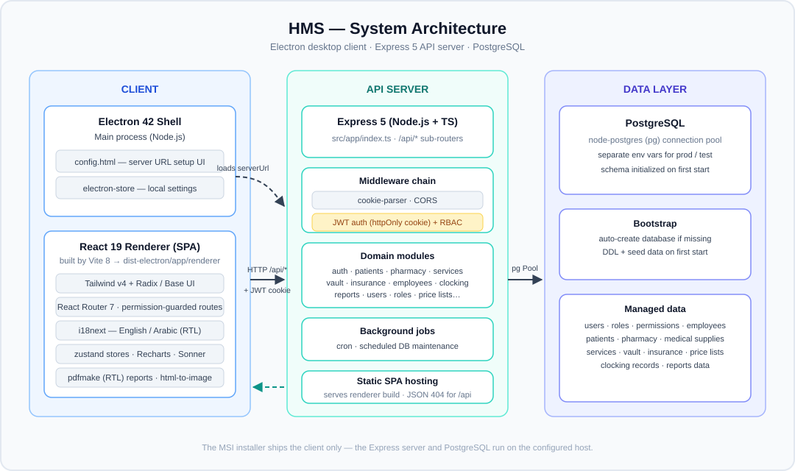
</p>

**Three-tier design:**

1. **Client tier** — the Electron main process shows a configuration window on first launch, validates the server URL with a `/api/health` probe, and then loads the configured remote `serverUrl`. The renderer is the built React SPA (`dist-electron/app/renderer`).
2. **Application tier** — Express 5 exposes 26 `/api/*` route groups (auth, patients, bills, pharmacy, supplies, services, price lists, insurance, vault, employees, doctors, clocking, reports, users, roles, permissions, audit logs, warehouses, dashboard). Cookie parsing and JWT verification run per-router; every mutating endpoint is wrapped by the audit middleware. The same server hosts the compiled SPA, returns JSON 404s for unknown `/api/*` paths, and exposes `GET /health` / `GET /api/health`.
3. **Data tier** — PostgreSQL accessed through a `pg` pool. On first boot the server creates the database if missing, applies the full schema (14 enum types, ~30 tables, 50+ indexes, 7 operational SQL views and helper functions), then seeds permissions, roles, accounts, a default price list, and a default warehouse.

> The MSI installer ships **only the client**. The API server and database run on the configured host, which is also what enables centralized multi-workstation deployments.

---

## Data Flow

<p align="center">
  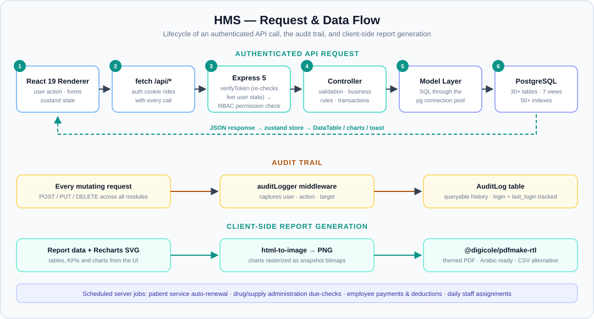
</p>

**Lifecycle of an authenticated request**

1. A user acts in the React renderer; forms validate locally with Zod and state is held in Zustand stores.
2. The renderer calls `/api/*` with `fetch`; the `auth` cookie travels with the request.
3. Express parses the cookie, then `verifyToken` re-reads the user's **live database state** on every request — deactivated or renamed accounts fail fast (401), which ends the client session.
4. Authorization helpers (`checkPermission`, `checkAnyPermission`, `checkPermissions`, `checkRole`, `adminOnly`, `checkSelfOrAdmin`) gate the handler. The privileged `Admin` and `System` roles bypass permission checks.
5. Controllers apply validation, business rules, and transactions; the model layer executes SQL through the `pg` pool.
6. Responses return as JSON; Zustand stores update and the UI reacts (DataTable, charts, Sonner toasts).

**Cross-cutting pipelines**

- **Audit trail** — every mutating request flows through `auditLogger` into the `AuditLog` table (user, action, target), alongside login events and `last_login` timestamps.
- **Report generation** — reports are generated **client-side**: report data and Recharts SVGs are captured with `html-to-image`, then composed into themed, Arabic-ready PDFs with `@digicole/pdfmake-rtl`; CSV exports are available for the same datasets.
- **Scheduled server jobs** — patient service auto-renewal, drug and medical-supply administration due-checks, employee payment/deduction processing, and daily staff assignments run on recurring cron schedules configured at server boot.

---

## Feature Matrix

### Authentication & Access Control

- Credential login with bcrypt verification; deactivated accounts rejected with `ACCOUNT_DEACTIVATED`.
- JWT session with **1-day expiry**, issued as an `auth` cookie (token also echoed in the login response for API clients).
- `GET /api/auth/verify` session re-validation on app load and per protected request.
- **20 granular permissions**: `view_dashboard`, `manage_patients`, `view_patients`, `manage_billing`, `manage_services`, `manage_prices`, `manage_pharmacy`, `manage_supplies`, `manage_shipments`, `manage_insurance`, `manage_employees`, `manage_clocking`, `manage_payments`, `manage_vault`, `view_vault`, `manage_reports`, `view_reports`, `manage_users`, `manage_settings`, `view_only`.
- Custom roles with a visual permission grid; `Admin` and `System` are privileged and protected server-side.
- Admin-only user management (create / edit / delete, role filtering) and role management.
- Client route guards: `PrivateRoute`, `PermissionRoute` (per-route permission map in `lib/routes.ts`), and `AdminRoute`; the sidebar is filtered per user.
- Full audit logging of mutating operations; login events and `last_login` tracking.

### Dashboard

- **Role-routed experience**: admins get 5 KPI tiles, a revenue line chart, a distribution donut, and recent activity; other users get a feature grid limited to their permitted modules.
- Server endpoints: `GET /api/dashboard/admin-statistics`, `/user-statistics`, `/chart-data`.

### Patients

- Multi-step patient **registration wizard**.
- **All Patients** list with search and server-driven paging.
- **Staff Status** tab: currently clocked-in doctors and nurses with their active patient assignments, polled every 30 seconds.
- **Patient detail** view with tabs:
  - *Profile* — demographics and contact data.
  - *Assigned* — active services, dispensed drugs, and medical supplies.
  - *Billing* — live bill totals with selective **discount and VAT scopes**, and a printable bill PDF.
  - *Admissions* — admission history and current admission state.
- Admissions workflow with per-patient doctor/nurse assignment history.
- Automated service renewal processing plus recurring drug/supply administration due-checks.

### Pharmacy (Drugs)

- Drug catalog with cards, stock levels, and pricing.
- Shipments and warehouses management (shared with supplies).
- Sell / dispense transactions with filtered search and suggestions.
- Usage tracking tied to shipments, with pending-usage monitoring.
- **Low-stock** and **near-expiry** monitoring endpoints and KPI strip.

### Medical Supplies

- Supplies inventory catalog with search.
- Shipments, warehouses, and dispense-to-patient flows.
- Usage history and replenishment monitoring.

### Services & Price Lists

- Service catalog CRUD with per-price-list pricing matrix, prepayment flags, and a drug picker for service components.
- Price lists: card-grid management, CRUD, default-list invariant enforcement, and a transactional bulk **Add Prices** flow.
- Doctor-specific service pricing.

### Insurance

- Insurance company CRUD with a deep-linkable detail view (`/insurance/:companyId`).
- Per-company patient coverage listing.
- Payment ledger: record payments, delete entries, clear balances.
- Company-wide and per-patient reports with **PDF and CSV** export.

### Vault (Cash Management)

- KPI summary strip with accordion revenue breakdowns: patient services, drugs, supplies, and payments.
- Date-range report dialog with PDF export.
- Manual payment recording gated by the `manage_vault` permission.

### Employees & HR

- Merged **Employees / Doctors** workspace with tabs; legacy `/doctors` deep links redirect into the doctor tab.
- Doctor records with service-price management.
- Employee payments: list, detail, create, mark-paid, and void flows.
- **Clocking**: clock-in/out actions, active clock-in board with quick clock-out, filtered history, and KPI strip.
- Automated payroll jobs: daily payments/deductions, hourly per-patient dismissal payments, and daily staff assignments.

### Reports

Six report tabs, each with URL-driven filters and per-tab session caching:

1. **Patients** — list and detail reports with PDF export.
2. **Doctors** — performance and assignment reporting with charts and PDF.
3. **Nurses** — assignment reporting with PDF.
4. **Statistics** — multi-chart analytics (bar, line, composed, dual-axis) with PDF.
5. **Employee Payments (Payroll)** — period summaries with charts and PDF.
6. **Clock-ins** — attendance reporting with charts and PDF.

All exports require the appropriate permission (`manage_reports`) and are generated client-side, including chart snapshots in the PDF.

### Platform & UX

- **Command palette** (cmdk) with keyboard navigation for fast module switching.
- **Four theme modes**: light, dark, **true-dark**, and system — with a keyboard toggle.
- **Accessible DataTable**: sorting, pagination, row expansion, keyboard support, and row motion.
- Standardized `PageHeader`, `ConfirmDialog`, `EmptyState`, and `StatCard` components.
- Sonner toast notifications and a logout confirmation flow.
- Breadcrumb navigation, sidebar collapse persistence, and a polished 404 experience.
- Dev-only component gallery at `/__dev/components` (automatically disabled in production).

---

## Screenshots

<details>

| | |
|---|---|
| 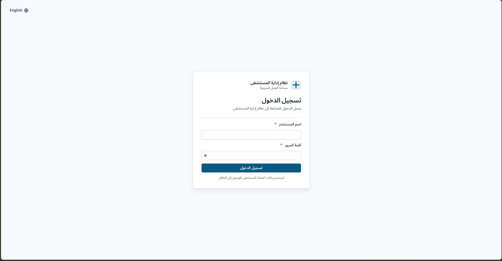 | 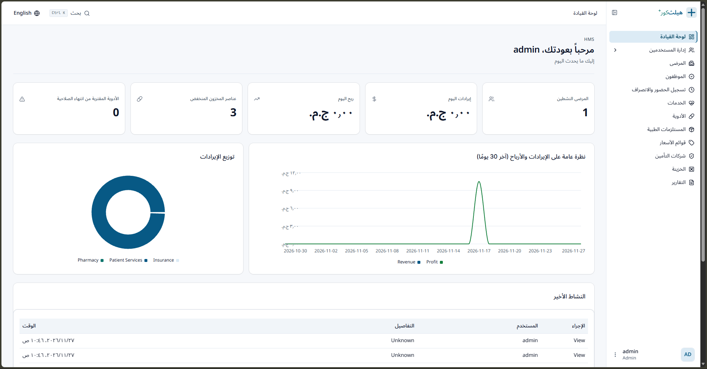 |
| 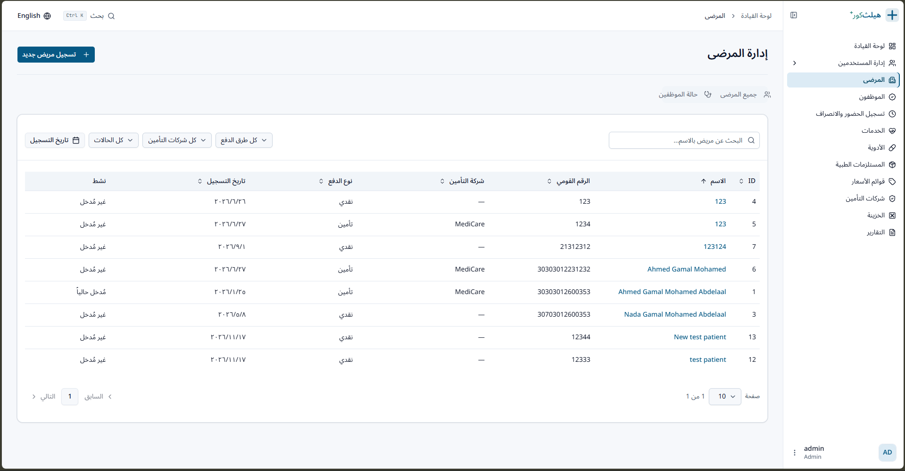 | 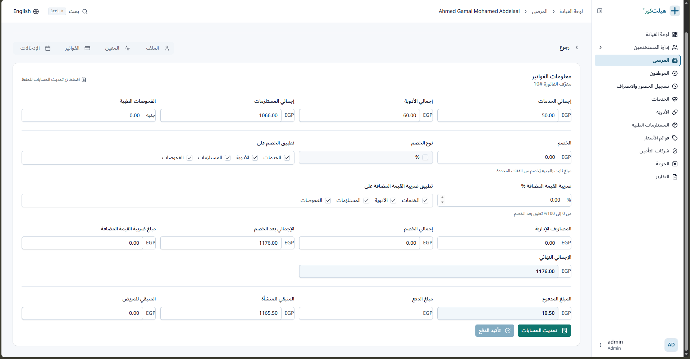 |
| 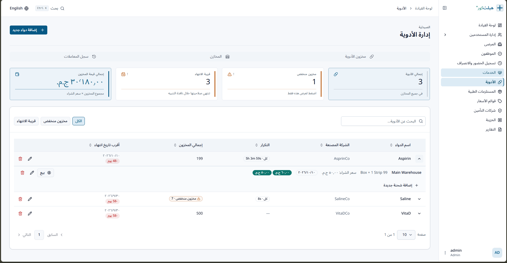 | 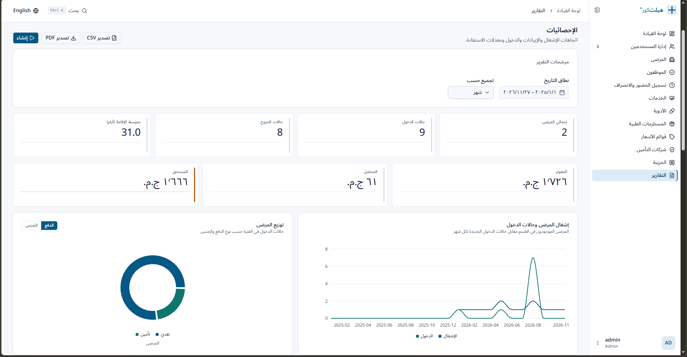 |
| 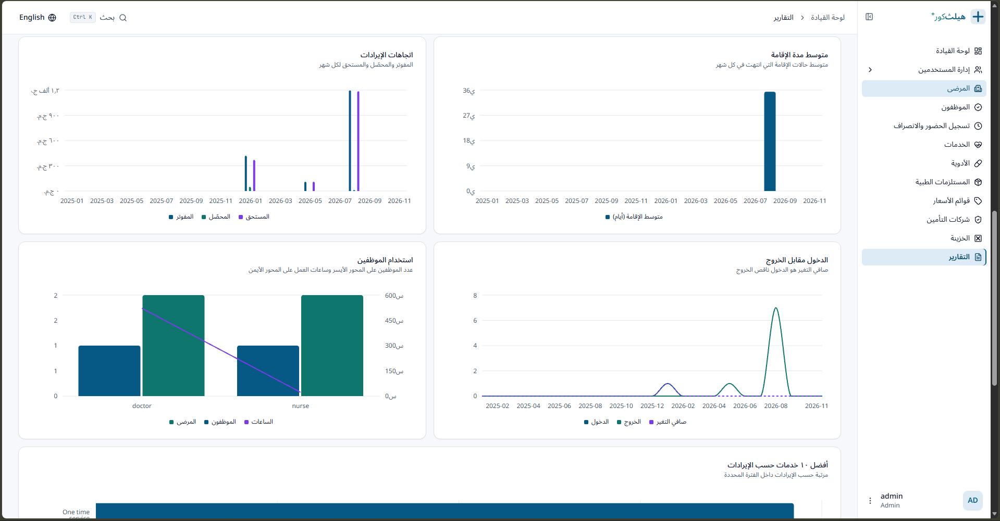 | 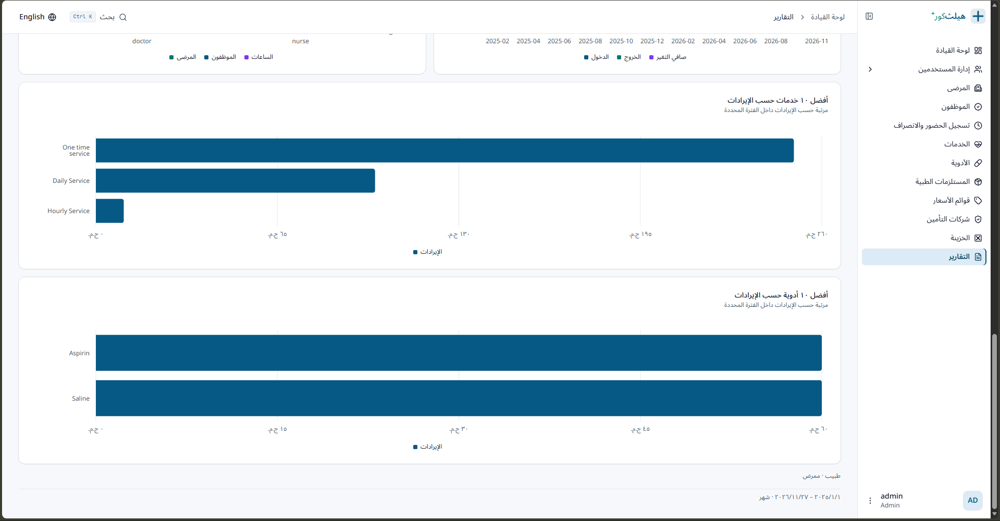 |
| 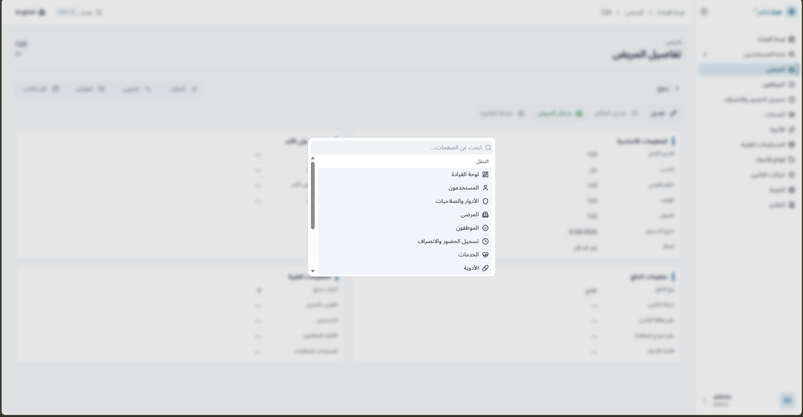 | 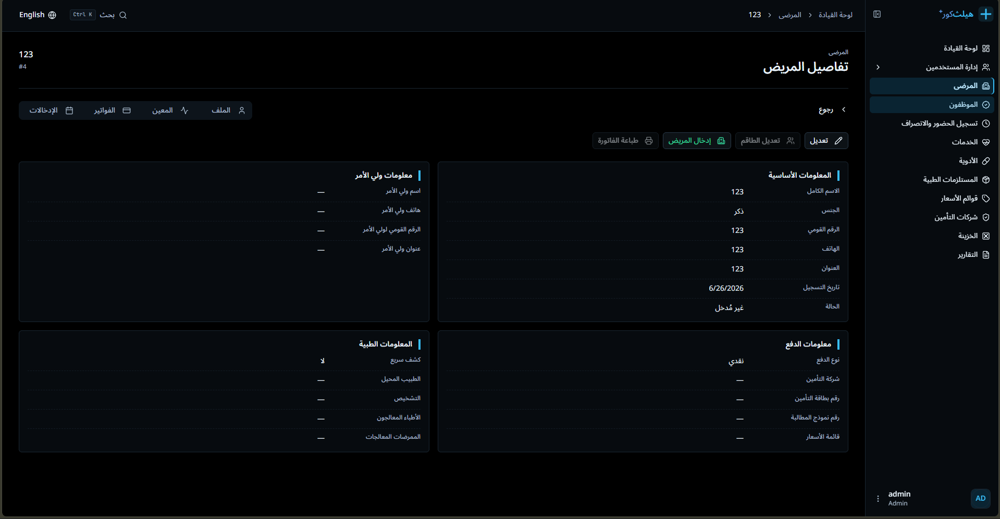 |


</details>

---

## Getting Started

### Prerequisites

| Requirement | Details |
|---|---|
| **Node.js 20 LTS or newer** | Required by Vite 8 and the TypeScript toolchain |
| **npm** | Ships with Node.js |
| **PostgreSQL server** | Reachable from the API server host; a dedicated database will be created automatically |
| **Windows** (optional) | Only needed to build the MSI installer; Linux/macOS can run the dev workflow |

### Installation & Environment

1. **Clone and install dependencies**

   ```bash
   git clone <repository-url> HealthCore-HMS
   cd HealthCore-HMS
   npm install
   ```

2. **Create the server environment file**

   The API server loads `src/app/.env`. Copy the values from `.ENV-EXAMPLE` and fill them in:

   | Variable | Purpose |
   |---|---|
   | `NODE_ENV` | Runtime mode (`development` / `production`) |
   | `DEV` | Development flag used by the server |
   | `JWT_SECRET` | Signing secret for session tokens — use a long random value |
   | `PORT` | Port the Express server listens on |
   | `DB_USER` / `DB_PASSWORD` | PostgreSQL credentials |
   | `DB_HOST` / `DB_PORT` | PostgreSQL host and port |
   | `DB_NAME` | Application database name (auto-created if missing) |
   | `DB_USER_TEST` / `DB_PASSWORD_TEST` | Test-database credentials (used by Jasmine) |
   | `DB_HOST_TEST` / `DB_PORT_TEST` | Test-database host and port |
   | `DB_NAME_TEST` | Test database name (schema initialized by the test helper) |

### First Run & Database Bootstrap

Start the API server — it handles the rest on first boot:

```bash
npm run dev:server
```

On startup the server will:

1. **Create the database** if it does not exist.
2. **Apply the schema**: 14 enum types, ~30 tables, 50+ indexes, 7 operational SQL views (`CurrentAdmissions`, `ServiceRenewalsDue`, `DrugAdministrationsDue`, `DrugReplenishmentNeeded`, `MedicalSupplyAdministrationsDue`, `MedicalSupplyReplenishmentNeeded`), and helper functions. The database timezone is set to `Africa/Cairo`.
3. **Seed baseline data**:
   - 20 permissions (listed in [Security Model](#security-model))
   - `Admin` and `System` role definitions
   - `admin` and `system` user accounts (bcrypt-hashed — the initial credentials are defined in the seed logic in `src/app/utils/setUpDatabase.ts`)
   - The `Default` price list and `Default` warehouse
4. Run the idempotent admin-schema upgrade (account status columns, `System` role bootstrap, `last_login` tracking).
5. Start the scheduled cron jobs and begin listening on `PORT`.

Verify the server is healthy:

```bash
curl http://localhost:<PORT>/api/health
# → { "status": "ok", "timestamp": ..., "service": "HMS API", "version": ... }
```

---

## Development Workflow

The project uses three cooperating processes. Run them in separate terminals:

| Command | What it does |
|---|---|
| `npm run dev:server` | Express API with `nodemon` + `tsx` (auto-restart), loading `src/app/index.ts` and `src/app/.env` |
| `npm run dev:renderer` | Vite dev server on **http://localhost:5173** with `/api` proxied to the Express server |
| `npm run dev:e` | Launches Electron from `build/electron/main.js` (requires `npm run build` first) |
| `npm run dev:te` | Builds everything, then launches Electron |

**Recommended loop:**

1. `npm run dev:server` — API + database.
2. `npm run dev:renderer` — open http://localhost:5173 in a browser for fast UI iteration (Vite HMR).
3. Before testing the desktop shell: `npm run build` once, then `npm run dev:e`.

> In browser-only mode the SPA talks to the API through Vite's proxy; the packaged Electron client loads the same build from the remote server URL instead.

**Additional quality commands:**

| Command | Purpose |
|---|---|
| `npm run lint` | ESLint over all TypeScript/TSX |
| `npm run format` | Prettier formatting |
| `npm run typecheck` | Targeted renderer + server type checks (never run root `tsc --noEmit` — the root config is solution-style) |
| `npm run check-i18n` | Audit translation keys for missing/unused entries |

---

## Production Build & Packaging

### Building

```bash
npm run build
```

This runs, **in order** (the steps must stay sequential):

1. `build:renderer` — Vite production build into `dist-electron/app/renderer`.
2. `build:app` — `tsc` for the Electron main process (`build/`) and the server (`dist-electron/app`).
3. `copyDist` — copies Electron assets and view HTML/CSS into `dist-electron/electron`.

### Packaging the desktop client

```bash
npm run dist
```

Runs the build, then `electron-builder --win --x64`, producing a **per-machine MSI installer** (non-one-click; appId `com.ahmed-gamal.hms`). The builder configuration in `electron-builder.json` also defines **macOS DMG** and **Linux AppImage** targets if built on those platforms.

### Deploying the server

The API server is the single deployment unit for the web surface:

- It serves the compiled SPA from `dist-electron/app/renderer`, with an Express 5 catch-all (`/{*splat}`) SPA fallback.
- Unknown `/api/*` paths return a **JSON 404** before the SPA fallback.
- `GET /health` and `GET /api/health` are available for load balancers and the Electron setup probe.
- Scheduled cron jobs start automatically with the server process.

Building on a machine where the app runs behind a service manager (systemd, PM2, Windows Service) is recommended for production.

---

## Desktop Client Configuration

The packaged client is a thin shell around the remote web app:

- **First launch**: a non-resizable configuration window (700×900) collects the server URL. **Save is only allowed after a successful `GET <serverUrl>/api/health` probe** (5s timeout).
- **Subsequent launches**: the Electron window (1920×1080, maximized) loads the configured `serverUrl`; if it becomes unreachable, a dedicated connection-error view is shown.
- **Re-open configuration** at any time with **Ctrl+Shift+C** (also available from the window menu).
- Settings persist locally via `electron-store`.
- DevTools shortcuts are blocked in production builds.
- There is no auto-update mechanism; distribute new MSI builds manually.

---

## Testing & Quality

### Backend — Jasmine (46 spec files)

```bash
npm run build   # compile specs into dist-electron/app/tests
npm test        # jasmine
# or:
npm run build:t # build + test in one step
```

Coverage includes model and controller suites for users, roles, permissions, price lists, services, patients, doctors, employees, employee payments, clock-ins, vault, drug cards/shipments/transactions/usages, bills, and all eight report domains, plus the auth middleware and dashboard service. Tests run against the dedicated `*_TEST` database using the same schema-initialization path as production (`db.helper.ts`).

### Renderer — Vitest (17 spec files)

```bash
npm run test:renderer
```

Covers route access rules, permission keys/grid, permission diffing, admin roles, command palette, i18n setup, date formatting, the patient schema, report parameters, chart table accessibility, and six report-export builders.

### Static checks

```bash
npm run lint
npm run typecheck
npm run check-i18n
```

---

## Security Model

| Concern | Implementation |
|---|---|
| **Credential storage** | bcrypt hashes (`bcryptjs`); account deactivation blocks login with 403 `ACCOUNT_DEACTIVATED` |
| **Session** | Signed JWT (`{userId, username, role, permissions}`), expiry **1 day**, delivered as the `auth` cookie; `verifyToken` accepts the cookie or an `Authorization: Bearer` header |
| **Live verification** | The middleware re-reads the user record from PostgreSQL on every request — deactivated or renamed accounts immediately receive 401 and the client ends the session |
| **Authorization** | Server-side permission helpers on every protected router; privileged `Admin`/`System` roles bypass checks by design |
| **Client guards** | Route-level `PrivateRoute` / `PermissionRoute` / `AdminRoute` plus per-user sidebar filtering — defense in depth, never the sole control |
| **Auditability** | `auditLogger` wraps all mutating routes into the `AuditLog` table; login and `last_login` events are recorded |
| **Surface hardening** | No CORS middleware (same-origin desktop traffic; Vite proxy in development), JSON 404s for unknown API paths, DevTools disabled in packaged builds |
| **Secrets** | All environment configuration lives in `src/app/.env` (never committed) and Electron config in `electron-store` |

**Permissions seeded on first run:** `view_dashboard`, `manage_patients`, `view_patients`, `manage_billing`, `manage_services`, `manage_prices`, `manage_pharmacy`, `manage_supplies`, `manage_shipments`, `manage_insurance`, `manage_employees`, `manage_clocking`, `manage_payments`, `manage_vault`, `view_vault`, `manage_reports`, `view_reports`, `manage_users`, `manage_settings`, `view_only`.

---

## Internationalization & RTL

- **Languages**: English (`en`) and Arabic (`ar`), with `en` as the fallback.
- **Structure**: 24 namespaces × 2 locales (48 JSON files) in `src/renderer/src/locales/`.
- **Loading strategy**: ten namespaces are baked on boot (`common`, `sidebar`, `navigation`, `topbar`, `breadcrumbs`, `breadcrumb`, `userMenu`, `errors`, `auth`, `success`); page namespaces lazy-load through `lazyLoadWithNamespace`.
- **RTL**: a global `RTLSync` component mirrors the document direction; Arabic typography uses Noto Sans Arabic alongside Inter and JetBrains Mono.
- **Persistence**: the selected language is stored in `localStorage` and exposed in `uiStore`.
- **Tooling**: `npm run check-i18n` reports missing and unused keys (`--strict`, `--locale` filters supported).
- **PDFs**: report builders use `@digicole/pdfmake-rtl`, so exported documents are Arabic-ready as well.

---

## Project Structure

```
HMS/
├── src/
│   ├── app/                        # Express 5 API server
│   │   ├── index.ts                # Entry: env, DB bootstrap, middleware, SPA hosting, cron
│   │   ├── routes/                 # 26 mounted /api sub-routers
│   │   ├── controllers/            # Request handlers and business logic
│   │   ├── models/                 # Data access (pg pool in models/database/)
│   │   │   └── database/           # connection.ts, migrations/
│   │   ├── middleware/             # auth.middleware, auditLogger, permission helpers
│   │   ├── cron/                   # Patient renewals, employee payments
│   │   ├── services/               # Dashboard aggregation
│   │   ├── utils/                  # setUpDatabase.ts, roles.ts, helpers
│   │   └── tests/                  # Jasmine specs + db.helper.ts
│   ├── electron/                   # Desktop shell
│   │   ├── main.ts                 # Windows, IPC, serverUrl probe, shortcuts
│   │   ├── preload.cjs
│   │   ├── utils/                  # configStore, paths, dev helpers
│   │   ├── views/                  # config.html, connection-error.html (+ css/js)
│   │   └── assets/                 # Icons
│   └── renderer/                   # React 19 SPA
│       ├── index.html
│       ├── vite.config.ts
│       └── src/
│           ├── main.tsx            # Bootstrap
│           ├── App.tsx             # Routes
│           ├── pages/              # 16 feature pages (lazy-loaded)
│           ├── components/         # ui/ (~55 primitives), common/, layout/, charts/
│           ├── store/              # zustand: authStore, uiStore, breadcrumbStore
│           ├── lib/                # routes.ts, navigation.ts, pdf/, pdfmake, commandPalette
│           ├── locales/            # 24 namespaces × en/ar
│           └── test/               # Vitest specs
├── docs/
│   ├── images/                     # Banner, architecture.svg, data-flow.svg
│   └── screenshots/                # Drop real captures here (see guide)
├── design.md                       # UI/UX design principles (tokens, a11y, motion)
├── color_theme_redesign_plan.md    # Implemented palette fixes
├── AGENTS.md                       # Developer/agent guide for this repo
├── electron-builder.json           # MSI / DMG / AppImage packaging config
├── .ENV-EXAMPLE                    # Environment variable template
└── package.json                    # HealthCore-HMS v0.5.2, scripts, dependencies
```

---

## Additional Documentation

| Document | Contents |
|---|---|
| [`design.md`](design.md) | UI/UX principles: token-driven palette, light/dark/true-dark parity, component specs, WCAG 2.1 AA accessibility, motion rules, responsive strategy |
| [`color_theme_redesign_plan.md`](color_theme_redesign_plan.md) | Implemented palette-consistency fixes and contrast corrections |
| [`AGENTS.md`](AGENTS.md) | Repository conventions: architecture, build commands, TypeScript configs, renderer patterns |
| [`docs/screenshots/README.md`](docs/screenshots/README.md) | Capture checklist and naming guide for the screenshot placeholders |

---

## License

Copyright © A* Software — **All Rights Reserved**.

This source code is protected under international copyright law. Redistribution, modification, or use outside the terms granted by the copyright holder is prohibited. See the [LICENSE](LICENSE) file for details.

---

<p align="center">
  <sub>HealthCore HMS v0.5.2 — built with Electron, React, Express, and PostgreSQL.</sub>
</p>
